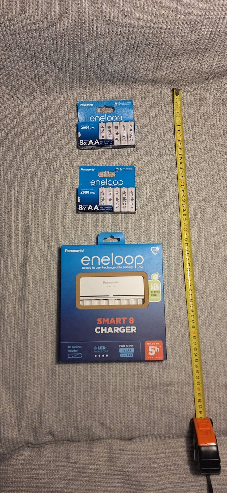
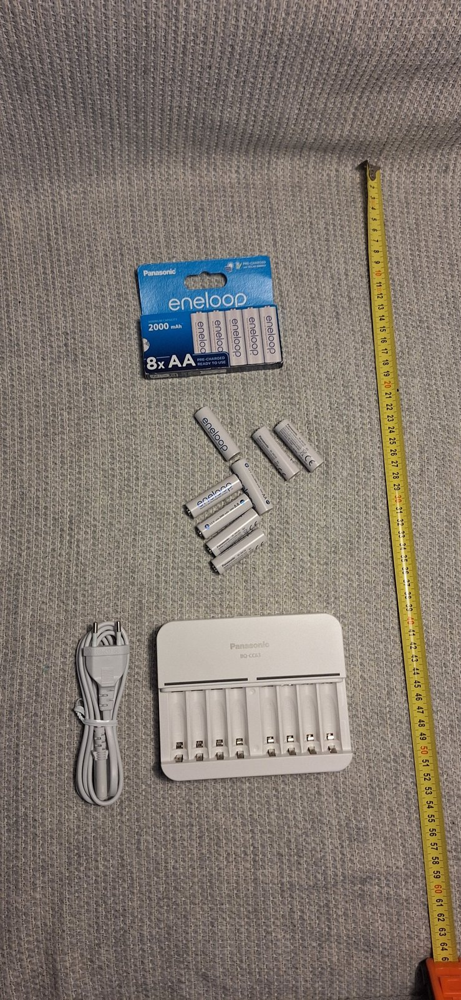
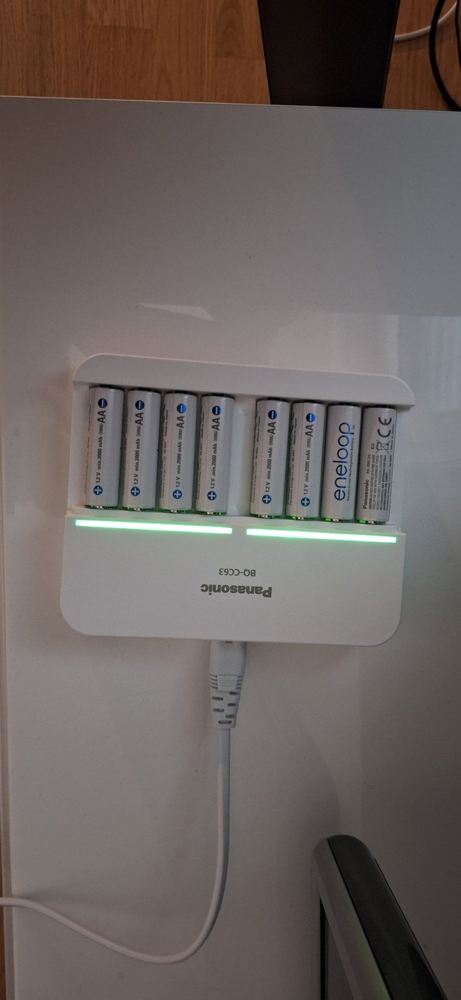

# Assembly — build log

Step-by-step build of the robot, with photos. Each stage: what was done, photos, problems and
how they were solved, time spent. Reference: [Romi 32U4 User's Guide](https://www.pololu.com/docs/0J69),
[Romi Chassis User's Guide](https://www.pololu.com/docs/0J68).

Status: 🟡 parts arriving — batteries and charger delivered 2026-11-12.

---

## 0. Parts unboxed

All parts from the [BOM](bom.md) laid out together.

<!-- photo: docs/photos/YYYY-MM-DD-parts-overview.jpg (when all parts are here) -->

**2026-11-12 — batteries and charger** (BOM #6, #7): 2× eneloop 8× AA 2000 mAh NiMH and the
Panasonic BQ-CC63 8-slot charger. The robot uses 6 cells; the other 10 are spares for swapping
during testing. First full charge done.

| Delivered | Unboxed (tape measure in cm) | Charging |
|---|---|---|
|  |  |  |

## 1. Soldering the 32U4 control board

Female 1×6 headers for the encoders, buzzer.

<!-- photos: board before, joints close-up, board after -->

## 2. Encoders on the motors

Encoder boards on the back of the motors, magnetic discs on the shafts.

## 3. Chassis and motors

Motors, wheels and ball caster on the Romi chassis.

## 4. Battery contacts and control board

Battery contacts soldered, 32U4 board mounted on the chassis.

## 5. First power-on and motor test

Batteries in, Pololu example firmware, both wheels and encoders checked.

<!-- short video/GIF: wheels turning -->

## 6. Raspberry Pi on the board

Pi mounted on standoffs, connected through the Pi header (power: see [D2](decisions.md#d2-power)).

## 7. Top plate and lidar

Top plate (~15×15 cm), RPLIDAR C1 mounted, USB to the Pi.

## 8. Complete robot

Finished robot from several sides; weight and dimensions.

---

## Lessons learned

<!-- What I would do differently. -->
